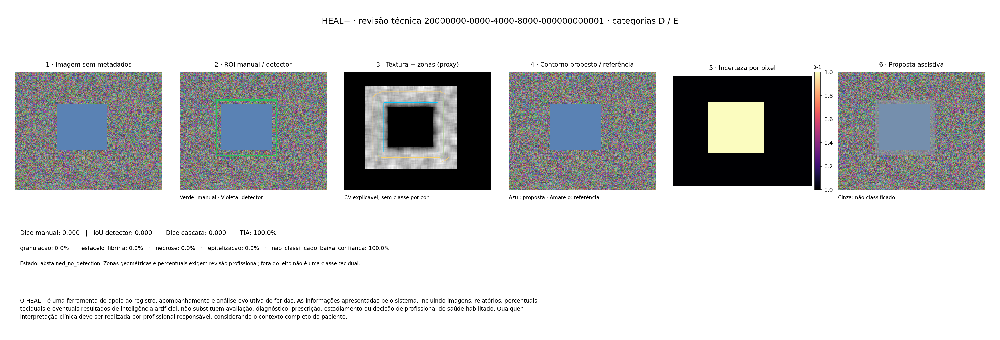

# Implementação e evidências das Sprints 1 e 2

**HEAL+ / REDI-SUS**

Relatório técnico de acompanhamento acadêmico. Ferraz de Vasconcelos, 19 de outubro de 2026.

## RESUMO

Este relatório apresenta a implementação das Sprints 1 e 2 do HEAL+ / REDI-SUS e suas evidências técnicas. O trabalho converteu requisitos clínicos e de sistema em módulos de registro estruturado, processamento de imagens, análise assistiva, inspeção visual, comparação temporal e exportação HL7 FHIR R4. O desenvolvimento utilizou Python, Pydantic, OpenCV, PyTorch e SQLite. Foram implementados controle de acesso, consentimento, remoção de metadados, auditoria e manifestos experimentais. A verificação local registrou 303 testes aprovados, sendo 231 da implementação e 72 regressões. Uma demonstração sintética gerou métricas, painel visual e um Bundle FHIR com sete recursos. Sem pesos treinados aprovados, a análise preservou a incerteza e não atribuiu tecidos. Os resultados demonstram integração e comportamento técnico nas condições testadas, sem comprovar desempenho clínico, equidade populacional ou homologação institucional. O próximo ciclo depende de dados autorizados, anotações profissionais, modelos identificados e estudos de avaliação.

**Palavras-chave:** feridas crônicas; software assistivo; visão computacional; interoperabilidade; reprodutibilidade.

<!-- SUMARIO_AUTOMATICO -->

## 1 INTRODUÇÃO

O HEAL+ / REDI-SUS prevê apoio ao registro estruturado e ao acompanhamento longitudinal de feridas. Seus requisitos clínicos incluem identificação mínima, localização, dimensões, composição tecidual, sinais observados, bordas, pele perilesional, imagens e condutas registradas por profissional. Os requisitos de sistema acrescentam controle de acesso, rastreabilidade, privacidade e interoperabilidade (Equipe HEAL+, 2026a, 2026b).

O objetivo desta entrega foi transformar os planos das duas sprints em código modular, testável e documentado. A Sprint 1 organiza a comparação entre localização da região de interesse e segmentação; a Sprint 2 estrutura a investigação de fatores fotográficos, clínicos e cutâneos associados às falhas (Sprint 1 [...], [s. d.]; Sprint 2 [...], [s. d.]). O avanço apresentado consiste na implementação dessas capacidades e em sua integração local. A conclusão dos experimentos com imagens reais permanece uma etapa posterior.

O relatório distingue três fontes de informação: os documentos fornecidos definem as necessidades do projeto; a documentação técnica fundamenta os recursos utilizados; e os testes e artefatos locais registram o que foi efetivamente executado. Essa distinção evita apresentar uma proposta de método ou um teste sintético como resultado clínico.

A organização segue a estrutura de relatório técnico descrita pela Universidade Federal de Santa Catarina (2019). A apresentação adota papel A4, margens superior e esquerda de 3 cm, inferior e direita de 2 cm, Arial 12 e entrelinhas de 1,5 no corpo. As citações seguem o sistema autor-data. As referências identificam documentos internos, código e fontes externas consultadas (Associação Brasileira de Normas Técnicas, 2024; Universidade Federal de Jataí, [s. d.]; Tribunal de Justiça do Distrito Federal e dos Territórios, 2026).

## 2 FONTES E PROCEDIMENTOS DE DESENVOLVIMENTO

### 2.1 Origem dos requisitos

Foram utilizados o levantamento clínico RT-HEAL-001, versão 1.0, de 17 de maio de 2026, e o levantamento de sistema RT-HEAL-002, versão 1.0, de 18 de maio de 2026. Eles fundamentam os campos clínicos, as permissões e a rastreabilidade. O material da reunião clínica orienta a avaliação separada do leito, das bordas e da pele perilesional, além das restrições à interpretação automática de cor e estágio (Equipe HEAL+, 2026a, 2026b; Feridas [...], [s. d.]).

Os dois planos de sprint detalham os experimentos, as métricas, o protocolo fotográfico e os fatores de inspeção. Foram tratados como especificação. Seus exemplos numéricos não foram incorporados como resultados do software; os resultados deste relatório provêm da execução local documentada (Sprint 1 [...], [s. d.]; Sprint 2 [...], [s. d.]; HEAL+ / REDI-SUS, 2026a, 2026b).

### 2.2 Construção e organização do código

A implementação foi produzida com apoio do assistente de programação Codex, a partir dos requisitos fornecidos e da inspeção do repositório. O trabalho foi dividido entre domínio e segurança, pipeline da Sprint 1 e módulos da Sprint 2, seguido de integração, revisão das interfaces e testes conjuntos. A geração assistida de código não substitui revisão técnica nem validação clínica.

O diretório heal_plus_redisus separa modelos de domínio, serviços, visão computacional, análise estatística e interoperabilidade. SprintsService conecta cadastro pseudonimizado, feridas, imagens, avaliações versionadas, histórico, análise e exportação. O decoder de imagens existente foi reutilizado, preservando as alterações locais anteriores. Não foram criadas novas telas nesta entrega (HEAL+ / REDI-SUS, 2026c).

Os modelos Pydantic verificam tipos, campos obrigatórios, percentuais, datas e vínculos. Os validadores implementam regras de consistência utilizando o mecanismo documentado pela biblioteca (Pydantic, [s. d.]). CEAP, WIfI, Fontaine e LPP são registros informados e revistos por profissional; não são calculados como diagnóstico a partir da fotografia (HEAL+ / REDI-SUS, 2026c).

### 2.3 Verificação e correções de integração

Foram criados testes sintéticos para verificar estados válidos, entradas inválidas e recusas de acesso. A revisão incluiu consultas antes da autorização, vínculos de imagens, identidade do revisor, sobreposição de ROIs e atualização concorrente de avaliações. Os ajustes impedem persistir análise obsoleta e combinam avaliação e resultados da mesma revisão na exportação (HEAL+ / REDI-SUS, 2026a, 2026c).

Ruff, mypy e a compilação Python complementaram os testes. A evidência se refere à execução local registrada em 19 de outubro de 2026; não corresponde à aprovação de CI remoto, à publicação em produção ou à revisão clínica independente (HEAL+ / REDI-SUS, 2026a).

## 3 IMPLEMENTAÇÃO DOS MÓDULOS

### 3.1 Região de interesse e segmentação híbrida

ROIHandler valida uma ou várias regiões de interesse na imagem original e preserva margem contextual de 25% por lado. O processamento obtém zonas geométricas de leito, transição de borda e entorno. Essas aproximações explicáveis não estabelecem, por si, fronteiras clínicas ou pele saudável (HEAL+ / REDI-SUS, 2026c).

A função extract_features reúne 27 canais: RGB, HSV, LAB, diferenças LAB relativas ao entorno, descritores de textura, zonas espaciais e contexto registrado. Nenhuma regra clássica transforma diretamente uma cor em tecido. A referência conceitual da rede é a U-Net de Ronneberger, Fischer e Brox (2015). No projeto, TissueProposalUNet foi implementada com saídas independentes para contorno e cinco classes teciduais; isso não constitui reprodução dos resultados experimentais do artigo original (HEAL+ / REDI-SUS, 2026c).

A função joint_loss combina entropia cruzada ponderada, Focal Tversky e perda binária do contorno. Ela disponibiliza uma base para treinamento futuro, mas nenhum treinamento clínico foi realizado nesta entrega. O adaptador verifica hash, versão e esquema dos pesos e utiliza weights_only=True. A documentação do PyTorch descreve esse mecanismo de carregamento restrito; origem e aprovação experimental dos pesos continuam necessárias (PyTorch, [s. d.]; HEAL+ / REDI-SUS, 2026c).

### 3.2 Incerteza e comparação dos experimentos

As classes previstas são granulação, esfacelo/fibrina, necrose, epitelização e não classificado/baixa confiança. A abstenção considera confiança, entropia, artefatos e suporte do contorno. Os limiares são técnicos e configuráveis. Sem checkpoint aprovado, o sistema não infere tecidos ou contorno; uma máscara profissional pode definir o suporte sem eliminar a incerteza da classificação (HEAL+ / REDI-SUS, 2026c).

CascadeEvaluator compara ROI manual seguida de segmentação com detector seguido de segmentação. As referências são utilizadas nas métricas; eventual máscara disponível ao operador é um parâmetro separado. São calculados Dice, IoU, sensibilidade, especificidade e mAP de uma classe, com limiares IoU de 0,50 a 0,95 e 101 pontos de interpolação. A implementação não equivale integralmente ao avaliador oficial COCO (HEAL+ / REDI-SUS, 2026c).

A taxa de incerteza assistiva usa a ROI como denominador; a incerteza no leito é informada separadamente. A rejeição E é independente e preserva a categoria de falha principal. Casos fora dos intervalos definidos permanecem intermediários. A incerteza elevada solicita revisão antes da interpretação dos percentuais (HEAL+ / REDI-SUS, 2026c).

### 3.3 Inspeção e acompanhamento temporal

O protocolo da Sprint 2 contém 24 características, com estados presente, ausente, desconhecido e não avaliado. A análise padrão compara falha D e controle A, excluindo registros sem revisão. Frequências, razões de prevalência e métricas podem ser separadas por dataset e tom de pele. Denominadores ausentes produzem resultado indeterminado. As comparações são descritivas e não demonstram causalidade ou equidade populacional (HEAL+ / REDI-SUS, 2026c).

A captura utiliza nitidez, reflexos e iluminação relativa, além de confirmações humanas. Distância de 20–30 cm e ângulo próximo de 90° exigem medida e origem informadas. O módulo temporal requer mesma pessoa e ferida, ordem cronológica, escalas e correspondências revisadas. Utiliza homografia com RANSAC, recurso documentado pelo OpenCV para estimar transformação entre planos. Regiões incertas são excluídas; alteração visual não é convertida automaticamente em cura ou piora (OpenCV, [s. d.]; HEAL+ / REDI-SUS, 2026c).

### 3.4 Privacidade e interoperabilidade

O upload exige consentimento registrado e revisão visual de privacidade. A orientação é aplicada antes da remoção de metadados e da persistência em PNG. Oito perfis são autorizados conforme instituição e vínculo assistencial. A auditoria utiliza eventos sem conteúdo clínico e encadeamento HMAC-SHA256. O encadeamento detecta alterações, mas não criptografa o banco e exige checkpoint externo para detectar truncamento (HEAL+ / REDI-SUS, 2026c).

Os controles respondem à sensibilidade dos dados e às necessidades de minimização do projeto. A LGPD classifica dados de saúde vinculados à pessoa como sensíveis; os mecanismos implementados não representam certificação jurídica ou dispensa de governança institucional (Brasil, 2018).

O exportador produz Bundle FHIR R4 collection ou transaction, verifica referências e utiliza schema offline derivado da versão 4.0.1. Bundle é o recurso de agrupamento definido pela HL7. Sua validação estrutural não comprova atendimento a perfis nacionais ou homologação RNDS. A exportação é local e depende de ação autorizada (HL7 International, [s. d.]; HEAL+ / REDI-SUS, 2026c).

## 4 EVIDÊNCIAS E DISCUSSÃO DOS RESULTADOS

### 4.1 Testes automatizados

O registro informa 303 testes aprovados em 57,15 segundos, sendo 231 da implementação e 72 regressões. A execução ocorreu no Windows, com Python 3.14.3, OpenCV 4.13.0, Pydantic 2.12.5 e PyTorch 2.11.0 CPU. O resultado foi produzido na validação do código; a preparação deste relatório conferiu os registros e artefatos, sem repetir a suíte completa (HEAL+ / REDI-SUS, 2026a).

Tabela 1 – Síntese das verificações locais

| Verificação | Evidência registrada |
|---|---|
| Testes da implementação | 231 aprovados |
| Regressões existentes | 72 aprovados |
| Rodada combinada | 303 aprovados em 57,15 s |
| Ruff e formatação | Aprovados |
| Mypy | Aprovado em 23 arquivos de código |
| Compilação Python | Aprovada |
| Demonstração integrada | Métricas, painel e Bundle gerados |

Fonte: HEAL+ / REDI-SUS (2026a).

As verificações incluem consentimento ausente, troca de usuário e instituição, restrição por perfil, metadados, integridade, ROIs múltiplas, abstenção, persistência e atualizações concorrentes. A matriz relaciona dez critérios CV e treze itens MT aos testes. Usabilidade, revisão visual, estudos reais e governança mantêm evidências humanas pendentes (HEAL+ / REDI-SUS, 2026a, 2026c).

### 4.2 Demonstração e interpretação

A demonstração utiliza uma imagem geométrica sintética, sem fotografias de pacientes. Ela percorre registro, inserção da imagem, análise, relatórios e exportação. A Figura 1 mostra o painel produzido; o original acompanha o relatório na pasta de evidências (HEAL+ / REDI-SUS, 2026b).

Figura 1 – Painel de seis etapas da execução sintética

Fonte: HEAL+ / REDI-SUS (2026b).

As etapas apresentam entrada, ROIs, características explicáveis, contorno e referência, incerteza e sobreposição assistiva. Os pesos estavam indisponíveis: Dice zero, TIA de 100% e sinalização D/E expressam a abstenção esperada nessa condição. Não devem ser utilizados para avaliar uma rede treinada (HEAL+ / REDI-SUS, 2026b).

O protocolo da Sprint 2 permanece sem inspeção profissional na demonstração. Os grupos analisados de falha e controle são 0 e 0. Portanto, não existem conclusões empíricas sobre fatores de falha ou diferenças entre tons de pele nessa amostra (HEAL+ / REDI-SUS, 2026b).

O Bundle contém Patient, Practitioner, Condition, Media, Observation, DiagnosticReport e Provenance. A estrutura e as referências foram verificadas localmente. Esse resultado demonstra a geração do pacote, sem transferência de dados ou comprovação de interoperabilidade operacional com a RNDS (HEAL+ / REDI-SUS, 2026b).

### 4.3 Reprodutibilidade e limites da evidência

O executor registra inventário, licença, grupos de paciente, splits, seed, versões e parâmetros. Antes da inferência, congela ROIs, contexto, máscaras e configuração em inputs.json. O hash do snapshot é vinculado ao manifesto e ao registro da execução. A conferência confirmou os sete hashes de artefatos listados no experimento, além dos vínculos do manifesto e das anotações (HEAL+ / REDI-SUS, 2026b, 2026c).

## 5 CONSIDERAÇÕES FINAIS

As Sprints 1 e 2 resultaram em módulos conectados de registro, processamento assistivo, inspeção e exportação. A novidade para o acompanhamento acadêmico é um fluxo executável com persistência, controle de acesso, incerteza explícita e evidências rastreáveis. Os 303 testes aprovados sustentam as afirmações técnicas nas condições verificadas; não encerram os experimentos empíricos previstos nos planos.

O próximo ciclo deve priorizar governança das bases, revisão das referências profissionais, comparação dos modelos e integração da captura à interface. Conclusões sobre segmentação, equidade e utilidade clínica deverão ser produzidas nesses estudos, preservando a responsabilidade profissional.

O frontend não foi alterado. Não foram realizados estudos com pacientes, benchmark real, testes de câmera, usabilidade profissional, homologação RNDS ou CI remoto. Não foi demonstrada redução de viés cutâneo em população. A próxima etapa exige dados autorizados e representativos, anotações profissionais, pesos identificados e calibração por dispositivo e contexto (HEAL+ / REDI-SUS, 2026a).

### 5.1 Aviso oficial de limitação clínica

O aviso abaixo é um requisito do projeto mantido integralmente nas saídas assistivas (HEAL+ / REDI-SUS, 2026c):

> O HEAL+ é uma ferramenta de apoio ao registro, acompanhamento e análise evolutiva de feridas. As informações apresentadas pelo sistema, incluindo imagens, relatórios, percentuais teciduais e eventuais resultados de inteligência artificial, não substituem avaliação, diagnóstico, prescrição, estadiamento ou decisão de profissional de saúde habilitado. Qualquer interpretação clínica deve ser realizada por profissional responsável, considerando o contexto completo do paciente.

## REFERÊNCIAS

ASSOCIAÇÃO BRASILEIRA DE NORMAS TÉCNICAS. **ABNT NBR 14724:2024: informação e documentação — trabalhos acadêmicos — apresentação**. 4. ed. Versão corrigida de 1 abr. 2025. Rio de Janeiro: ABNT, 2024. Disponível em: https://engenhariaedesenvolvimentosustentavel.ufes.br/sites/engenhariaedesenvolvimentosustentavel.ufes.br/files/field/anexo/abnt_nbr_14724.pdf. Acesso em: 19 out. 2026.

BRASIL. **Lei nº 13.709, de 14 de agosto de 2018**. Lei Geral de Proteção de Dados Pessoais (LGPD). Brasília, DF: Presidência da República, 2018. Texto compilado. Disponível em: https://planalto.gov.br/ccivil_03/_ato2015-2018/2018/lei/l13709compilado.htm. Acesso em: 19 out. 2026.

EQUIPE HEAL+. **REDI-SUS / HEAL+: levantamento de requisitos clínicos**. Versão 1.0. Ferraz de Vasconcelos: Equipe HEAL+ / REDI-SUS, 17 maio 2026a. RT-HEAL-001. Documento interno fornecido no arquivo “Documento de Pedro Tescaro.docx”.

EQUIPE HEAL+. **REDI-SUS / HEAL+: levantamento de requisitos do sistema**. Versão 1.0. Ferraz de Vasconcelos: Equipe HEAL+, 18 maio 2026b. RT-HEAL-002. Documento interno fornecido no arquivo “Documento de Pedro Tescaro 2.docx”.

FERIDAS crônicas, classificação clínica e aplicação no desenvolvimento do sistema. [S. l.: s. n.], [s. d.]. Material interno de reunião fornecido no arquivo “Documento de Pedro Tescaro 3.docx”. Consultado em: 19 out. 2026.

HEAL+ / REDI-SUS. **Evidências técnicas das Sprints 1 e 2**. Repositório local healplus, 19 out. 2026a. Arquivo: heal_plus_redisus/VALIDATION.md. Registro de execução local.

HEAL+ / REDI-SUS. **Execução sintética das Sprints 1 e 2 e seus artefatos**. Repositório local healplus, 19 out. 2026b. Diretório: artifacts/generated/heal-sprints-evidence-20261019/. Inclui manifesto, inputs.json, experiment_run.json, aggregate.json, painel e synthetic-bundle.json. Demonstração sem pacientes reais.

HEAL+ / REDI-SUS. **Sprints 1 e 2: código-fonte e documentação de implementação**. Versão 0.1.0. Repositório local healplus, 19 out. 2026c. Diretório: heal_plus_redisus/. Inclui README.md, src/, config/validation_matrix.json e tests/. Código local não publicado nesta entrega.

HL7 INTERNATIONAL. **FHIR Release 4: resource Bundle**. Versão 4.0.1. [S. l.]: HL7 International, [s. d.]. Disponível em: https://hl7.org/fhir/R4/bundle.html. Acesso em: 19 out. 2026.

OPENCV. **Camera calibration and 3D reconstruction**. OpenCV 4.13.0 documentation. [S. l.]: OpenCV, [s. d.]. Disponível em: https://docs.opencv.org/4.13.0/d9/d0c/group__calib3d.html. Acesso em: 19 out. 2026.

PYDANTIC. **Validators**. Pydantic documentation. [S. l.]: Pydantic, [s. d.]. Disponível em: https://docs.pydantic.dev/latest/concepts/validators/. Acesso em: 19 out. 2026.

PYTORCH. **Serialization semantics**. PyTorch 2.11 documentation. [S. l.]: PyTorch, [s. d.]. Disponível em: https://docs.pytorch.org/docs/2.11/notes/serialization.html. Acesso em: 19 out. 2026.

RONNEBERGER, Olaf; FISCHER, Philipp; BROX, Thomas. **U-Net: convolutional networks for biomedical image segmentation**. [S. l.]: arXiv, 2015. arXiv:1505.04597. Disponível em: https://arxiv.org/abs/1505.04597. Acesso em: 19 out. 2026.

SPRINT 1 — Análise de falhas do pipeline assistivo (YOLO vs. U-Net + CV), tríade clínica e estruturação HL7 FHIR R4. [S. l.: s. n.], [s. d.]. Plano interno fornecido no arquivo “sprint_1_an_lise_de_falhas_do_pipeline_assistivo_tr_ade_cl_nica_e_estrutura_o_fhir.md”. Consultado em: 19 out. 2026.

SPRINT 2 — Diagnóstico visual e clínico das imagens críticas, protocolo de captura e mitigação de vieses. [S. l.: s. n.], [s. d.]. Plano interno fornecido no arquivo “sprint_2_diagn_stico_visual_cl_nico_protocolo_fotogr_fico_e_equidade_cut_nea.md”. Consultado em: 19 out. 2026.

TRIBUNAL DE JUSTIÇA DO DISTRITO FEDERAL E DOS TERRITÓRIOS. **Referências bibliográficas**. Brasília, DF: TJDFT, 2026. Atualizado em 21 maio 2026. Orientações baseadas na ABNT NBR 6023:2025. Disponível em: https://www.tjdft.jus.br/institucional/biblioteca/servicos-e-produtos/referencias-bibliograficas/13.-referencias-bibliograficas. Acesso em: 19 out. 2026.

UNIVERSIDADE FEDERAL DE JATAÍ. Sistema de Bibliotecas. **Apresentação de citações em documentos — ABNT NBR 10520:2023**. Jataí: UFJ, [s. d.]. Disponível em: https://sibi.ufj.edu.br/apresentacao-de-citacoes-em-documentos-abnt-nbr-105202023/. Acesso em: 19 out. 2026.

UNIVERSIDADE FEDERAL DE SANTA CATARINA. Biblioteca Universitária. **Tutorial relatório técnico e/ou científico**. Florianópolis: UFSC, 2019. Item publicado em jul. 2019, com arquivo atualizado em 11 ago. 2023. Disponível em: https://repositorio.ufsc.br/handle/123456789/198047. Acesso em: 19 out. 2026.

## APÊNDICE A – LOCALIZAÇÃO DAS FONTES NO REPOSITÓRIO

Os caminhos são relativos à raiz do projeto. O código completo permanece na entrega, sem transcrição extensa no relatório. Para os arquivos apresentados em sequência, o diretório indicado no início do parágrafo vale para todos eles.

Domínio e segurança, em heal_plus_redisus/src/: domain/clinical_models.py; domain/capture_models.py; domain/rbac_audit.py; privacy.py; service.py.

Sprint 1, em heal_plus_redisus/src/sprint1_pipeline/: roi_handler.py; hybrid_segmenter.py; neural.py; cascade_evaluator.py; report_sprint1.py.

Sprint 2, em heal_plus_redisus/src/sprint2_clinical_visual/: visual_inspector.py; statistical_analyzer.py; guided_capture_validator.py; temporal_heatmap.py.

Reprodutibilidade, em heal_plus_redisus/src/: experiment.py; experiment_runner.py; interoperability/fhir_exporter.py. Extração do schema: heal_plus_redisus/scripts/vendor_fhir_schema.py.

Testes e critérios, em heal_plus_redisus/: tests/test_sprints_validation.py; demais arquivos tests/test_*.py; config/validation_matrix.json; VALIDATION.md.

Evidências: artifacts/generated/heal-sprints-evidence-20261019/. O índice de conferência e o painel estão também em docs/research/evidencias_sprints_1_2/.

O comando da rodada de testes registrada foi: python -m pytest heal_plus_redisus/tests tests/test_image_quality.py tests/test_fhir_r4_layer.py tests/test_segmentation_metrics.py -q.

Uma nova demonstração pode ser executada com: python -m heal_plus_redisus --output artifacts/generated/nova_execucao. A pasta de saída deve ser nova. A demonstração permanece sintética e sem pesos; não substitui o benchmark clínico.
